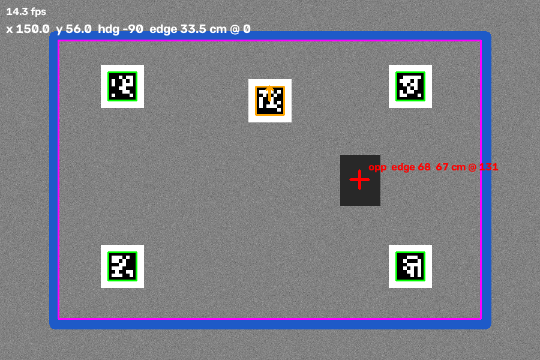
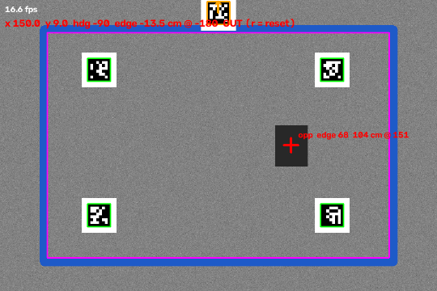

# 😀 sumo-wrestler

A LEGO sumo robot for a blue-tape ring. An overhead camera on a laptop tracks
both robots and sends the match state over MQTT to the Arduino UNO Q, which
reads its own sensors and runs a behavior tree. When the robot is pushed out,
it stops and plays a sad song.

## Layout

```
laptop/            vision system (runs on the laptop)
  config.yaml      camera, tag IDs and sizes, tape color, robot size
  make_tags.py     print the AprilTags -> tags.pdf
  view_tags.py     live check that the camera sees the tags
  calibrate.py     survey floor tags + ring -> calibration.json
  track.py         live tracker; publishes the state over MQTT
  opponent.py      opponent finder used by track.py
  geometry.py      shared detection and floor-geometry helpers
python/main.py     UNO Q Linux side (currently: ultrasonic test)
sketch/            UNO Q microcontroller (currently: HC-SR04 on D9/D10)
docs/              screenshots
```

## Vision system

An iPhone (via DroidCam) looks down at the ring. Everything is measured in
**floor cm**: the anchor tag's corner is the origin, x runs along its top edge
and y along its side edge.

- **Floor tags** (tag36h11, IDs 21–24, 16 cm) lie on the floor around the ring.
  Every frame, the visible floor tags give a fresh image → floor mapping (a
  homography), so a bumped camera doesn't break tracking.
- **Our robot** has tag 20 on top, which gives its position and heading.
- **The ring** is found once, at calibration: blue pixels in a top-down view
  are cleaned up into the tape loop, and the hole inside it is the ring's inner
  edge, saved as a polygon.
- **The opponent** needs no tag. Inside the ring, the rug color is fit as a
  smooth gradient (robots are dropped from the fit as outliers). Anything far
  from it, minus floor tags and a circle around our robot, is an object, and
  the biggest blob is the opponent.

### Setup

```
pip install -r laptop/requirements.txt
python laptop/make_tags.py      # print tags.pdf at 100% scale
python laptop/view_tags.py      # check the camera sees every tag
```

### During Match

1. Put the floor tags down, keeping them off the tape.
2. `python laptop/calibrate.py`. Press `c` to capture and check that the
   magenta line traces the tape's inner edge (click the tape to resample its
   color if not), then press `s` to save. The ring may have robots in it.
3. `python laptop/track.py --mqtt` (add `--broker localhost` for a local
   broker). Keys: `o` shows the opponent mask, `r` resets `out` between rounds,
   `q` quits.

### Tracker view (synthetic test)

| Approaching the edge | Pushed out |
|---|---|
|  |  |

Magenta = ring inner edge, green = floor tags, orange = our tag and heading,
red cross = opponent.

### MQTT state

`track.py --mqtt` publishes one JSON message per frame (about 30 Hz) to
`dchoate119/sumo/state` on `test.mosquitto.org`:

```json
{"t": 1729361234.52, "seen": true,
 "x": 150.0, "y": 56.0, "heading": -90.0,
 "edge": 33.5, "edge_bearing": 0.0, "center_bearing": -180.0, "out": false,
 "opp_seen": true, "opp_x": 200.0, "opp_y": 100.0,
 "opp_edge": 67.5, "opp_dist": 66.6, "opp_bearing": 131.3}
```

| field | meaning |
|---|---|
| `t` | laptop time (s), to spot stale data |
| `seen` | our tag was found; if false, the pose fields are left out |
| `x`, `y`, `heading` | our position (cm) and heading (deg, from +x toward +y) |
| `edge` | cm to the ring's inner edge, negative once past it |
| `edge_bearing` | direction to the nearest edge point, relative to our heading |
| `center_bearing` | direction to the ring center, relative to our heading |
| `out` | fully past the edge for 0.5 s; stays true until reset |
| `opp_seen` | opponent found; if false, the `opp_` fields are left out |
| `opp_x`, `opp_y`, `opp_edge` | opponent position and its distance to the edge |
| `opp_dist`, `opp_bearing` | cm and direction from us to the opponent (only when `seen`) |

Bearings are degrees in [-180, 180), 0 = straight ahead.

When `track.py` quits, it sends one last message with `seen` and `opp_seen` false.

## UNO Q (in progress)

- Sensors: HC-SR04 ultrasonic on 5V, Trig D9, Echo D10 (working).
- Next: subscribe to the MQTT state, then the behavior tree, motors, and the
  sad song.
