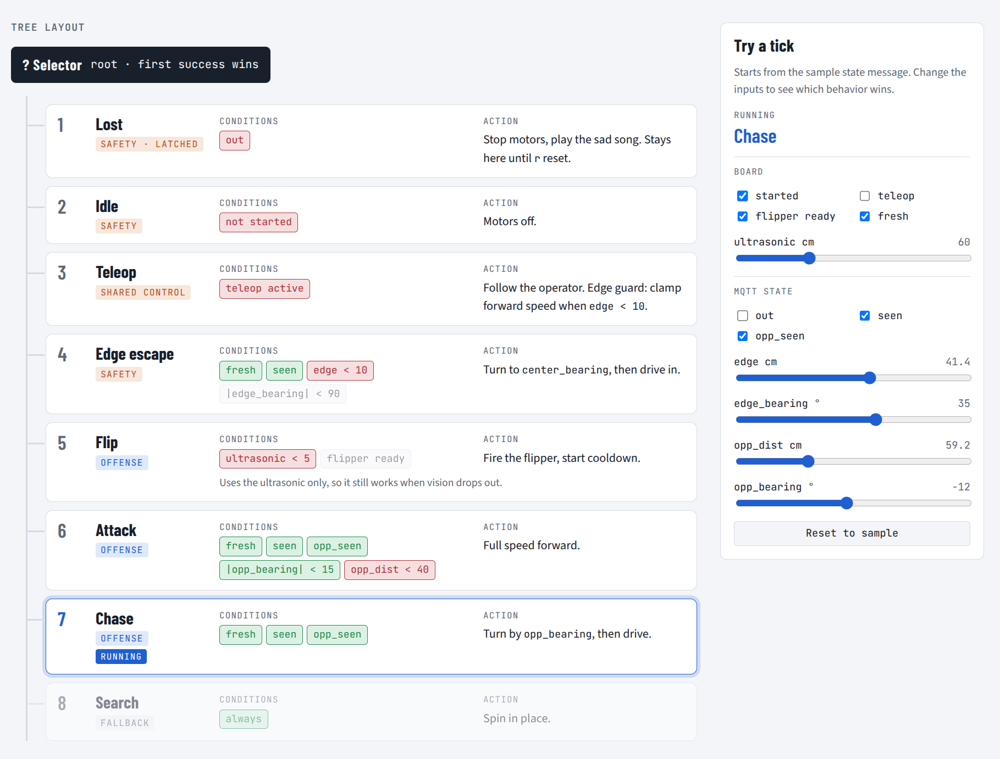

# 😀 sumo-wrestler

A LEGO sumo robot for a blue-tape ring. An overhead camera on a laptop tracks
both robots and sends the match state over MQTT to the Arduino UNO Q, which
reads its own sensors and runs a behavior tree. A LEGO motor flips the
opponent on contact. When the robot is pushed out, it stops and the laptop
plays a sad song.

## Layout

```
laptop/            vision system (runs on the laptop)
  config.yaml      camera, tag IDs and sizes, tape color, robot size
  make_tags.py     print the AprilTags -> tags.pdf
  view_tags.py     live check that the camera sees the tags
  calibrate.py     survey floor tags + ring -> calibration.json
  track.py         live tracker; publishes the state over MQTT
  opponent.py      opponent finder used by track.py
  geometry.py      shared detection and floor-geometry helpers
  lego_bridge.py   MQTT flip -> LEGO double motor over BLE
  sad_song.py      played by track.py when we're pushed out
  mosquitto.conf   local MQTT broker
python/main.py     UNO Q Linux side: MQTT in, ticks the tree, drive/flip out
python/bt.py       behavior tree (test_bt.py: scenario tests)
sketch/            UNO Q microcontroller: drive(), distance(), imu_read()
docs/              screenshots
```

## Vision system

An iPhone (via DroidCam) looks down at the ring. Everything is measured in
**floor cm**: the anchor tag's corner is the origin, x runs along its top edge
and y along its side edge.

- **Floor tags** (tag36h11, IDs 21–24, 16 cm) lie on the floor around the ring.
  Every frame, the visible floor tags give a fresh image → floor mapping (a
  homography), so a bumped camera doesn't break tracking.
- **Our robot** has tag 20 on top, which gives its position and heading.
- **The ring** is found once, at calibration: blue pixels in a top-down view
  are cleaned up into the tape loop, and the hole inside it is the ring's inner
  edge, saved as a polygon. The color range starts from `ring_hsv` in
  `config.yaml`; clicking the tape resamples it. Our tape is a dull blue, so
  the config range is wide (`[[95, 20, 20], [125, 255, 255]]`).
- **The opponent** needs no tag. Inside the ring, the rug color is fit as a
  smooth gradient (robots are dropped from the fit as outliers). Anything far
  from it, minus floor tags and a circle around our robot, is an object, and
  the biggest blob is the opponent. Known issue: a dark spot on the floor can
  win over the opponent.

### Setup

```
pip install -r laptop/requirements.txt
python laptop/make_tags.py      # print tags.pdf at 100% scale
python laptop/view_tags.py      # check the camera sees every tag
```

### Tracker view (synthetic test)

| Approaching the edge | Pushed out |
|---|---|
|  |  |

Magenta = ring inner edge, green = floor tags, orange = our tag and heading,
red cross = opponent.

### MQTT state

`track.py --mqtt` publishes one JSON message per frame (about 30 Hz) to
`dchoate119/sumo/state` (default broker `test.mosquitto.org`; we use
`--broker localhost`):

```json
{"t": 1729361234.52, "mode": "auto", "seen": true, "held": false,
 "x": 150.0, "y": 56.0, "heading": -90.0,
 "edge": 33.5, "edge_bearing": 0.0, "center_bearing": -180.0, "out": false,
 "opp_seen": true, "opp_x": 200.0, "opp_y": 100.0,
 "opp_edge": 67.5, "opp_dist": 66.6, "opp_bearing": 131.3}
```

| field | meaning |
|---|---|
| `t` | laptop time (s), to spot stale data |
| `mode` | `idle` (robot holds still) or `auto` (behavior tree runs) |
| `seen` | our tag was found; if false, the pose fields are left out |
| `held` | tag lost for under 0.5 s; the pose is the last one seen |
| `x`, `y`, `heading` | our position (cm) and heading (deg, from +x toward +y) |
| `edge` | cm to the ring's inner edge, negative once past it |
| `edge_bearing` | direction to the nearest edge point, relative to our heading |
| `center_bearing` | direction to the ring center, relative to our heading |
| `out` | fully past the edge for 0.5 s; stays true until reset |
| `opp_seen` | opponent found; if false, the `opp_` fields are left out |
| `opp_held` | opponent lost for under 0.5 s; its position is the last one found |
| `opp_x`, `opp_y`, `opp_edge` | opponent position and its distance to the edge |
| `opp_dist`, `opp_bearing` | cm and direction from us to the opponent (only when `seen`) |

Bearings are degrees in [-180, 180), 0 = straight ahead.

When `track.py` quits, it sends one last message with `seen` and `opp_seen` false.

## System

```
laptop: track.py ──state──►  UNO Q Python: behavior tree ──Bridge──► UNO Q sketch: drive motors,
laptop: teleop ─────teleop───►      │                                   ultrasonic, accelerometer
laptop: lego_bridge.py ◄──flip──────┘
        └── BLE ──► LEGO Education double motor (flipper)
```

- **Laptop** publishes the match state and teleop commands. It never decides
  anything. `lego_bridge.py` relays flip commands to the LEGO motor over BLE
  (the `legoeducation` library needs Python 3.14 + Bluetooth, which the board's
  container lacks).
- **UNO Q Python** merges MQTT state with board sensors and ticks the behavior
  tree. The tree outputs `drive(l, r)` and an optional flip.
- **UNO Q sketch** drives the two motors (from door-to-door), reads the
  HC-SR04 (5V, Trig D9, Echo D10) and the accelerometer (from ping-pong), and
  stops the motors if no `drive` call arrives for 200 ms.

### Behavior tree



A selector ticked at 20 Hz: the first behavior whose conditions all pass runs.
State older than 0.3 s (by arrival time) is stale and counts as idle. In
priority order:

1. **Lost**: `out` is true. Stop.
2. **Idle**: `mode` isn't `auto`, or state is stale. Stop.
3. **Edge escape**: within `EDGE_CM` of the edge and facing it. Turn and drive
   toward the center until `EDGE_CLEAR_CM` in.
4. **Flip**: ultrasonic under `FLIP_CM` and cooldown passed. Publish `flip`.
5. **Attack**: opponent within `ATTACK_DEG` and `ATTACK_CM`. Drive at it fast.
6. **Chase**: opponent seen. Turn and drive toward it.
7. **Search**: spin in place.

Teleop (overrides auto while controls are touched) is planned, not built.

### MQTT topics

All under `dchoate119/sumo/` on a local broker on the laptop.

| topic | from → to | content |
|---|---|---|
| `state` | laptop → UNO Q | see above, ~30 Hz |
| `behavior` | UNO Q → laptop | running behavior name, retained, shown in `track.py` |
| `flip` | UNO Q → laptop | one message per flip, never repeated |
| `teleop` | laptop → UNO Q | planned: `{"l", "r", "flip"}`, ~20 Hz, only while controls are touched |

The teleop **hold** button publishes `{"l": 0, "r": 0}` while pressed, so the
robot stands still under teleop instead of returning to auto.

## To do

**Laptop**
- [x] Run mosquitto locally; point `track.py` and the UNO Q at it
- [x] `lego_bridge.py`: connect to the double motor, run flips off the MQTT
      thread, ignore flips while one is running
- [x] `track.py`: keys to set `mode` (`idle` / `auto`), sent in every state message
- [x] Sad song on `out`
- [x] Calibrate the ring with the dull blue tape 
- [ ] Teleop publisher (keyboard or gamepad): publish only while controls are
      touched, plus a hold button that publishes zeros

**UNO Q sketch**
- [x] `drive(l, r)` for both motors, with the 200 ms watchdog
- [x] Ultrasonic and accelerometer reads exposed over the Bridge

**UNO Q Python**
- [x] MQTT subscriber that fills the blackboard and stamps arrival time
- [x] Behavior tree (7 behaviors above), outputting `drive` + `flip`
- [x] `try/finally` around `App.run()` that sends `drive(0, 0)`
- [ ] Teleop pass-through with edge guard; active while teleop is < 0.5 s old

**Tuning**
- [x] Measure flip time (~1 s), set `FLIP_COOLDOWN_S` (1.5 s)
- [x] Tune thresholds (`EDGE_CM`, `FLIP_CM`, `ATTACK_CM`, `ATTACK_DEG`) on the ring

## During match

1. Put the floor tags down (off the tape), then `python laptop/calibrate.py`:
   `c` to capture, `m` to check the tape mask, `s` to save.
2. Start the board app: `python3 tools/deploy.py sumo-wrestler` (from the
   workspace root). Check `app list` shows it running, not another app.
3. Terminal 1: `mosquitto -c laptop/mosquitto.conf -v`
4. Terminal 2: rest the flipper arm down, then `python laptop/lego_bridge.py`
   (`--test` flips on Enter, no MQTT).
5. Terminal 3: `python laptop/track.py --mqtt --broker localhost`. Keys: space
   start/stop, `r` reset `out`, `o` opponent mask, `q` quit.
